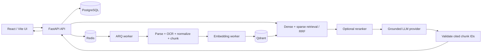

# DocuAsk

Bilingual, citation-grounded document question answering. Project status: architecture and planning only (phase 0). No application functionality is implemented yet.

## Problem

Users need answers from PDF, DOCX, TXT, and Markdown documents in Arabic, English, or both. A credible answer must identify the source document and passage rather than merely sound plausible. Arabic PDFs introduce extraction errors, mixed directionality, and orthographic variants that change retrieval quality.

## Intended capabilities

- Account-based document and chat isolation.
- Validated uploads with asynchronous, retryable ingestion.
- Arabic-aware parsing, preservation of original source text, and normalized retrieval text.
- Dense/sparse hybrid retrieval using reciprocal rank fusion and optional cross-encoder reranking.
- Answers constrained to retrieved evidence, validated source references, and explicit refusal for insufficient evidence.
- Streaming UI and PDF citation navigation with passage highlights when reliable offsets/bounding boxes are available.
- Reproducible retrieval evaluation rather than synthetic benchmark claims.

## Architecture

See [architecture](docs/architecture.md), [data model](docs/data-model.md), and [phase plan](docs/roadmap.md).

## Technology decisions

Python 3.11, FastAPI, Pydantic v2, SQLAlchemy 2 async, Alembic, PostgreSQL, Redis/ARQ, Qdrant, multilingual-e5 with a benchmarked bge-m3 alternative, optional multilingual cross-encoder, configurable OpenAI-compatible/Ollama providers, React/TypeScript/Vite/Tailwind, TanStack Query, React Router, react-pdf, SSE, Prometheus, structlog, pytest and Vitest.

## Status and verification

| Item | State |
| --- | --- |
| Architecture and data design | Drafted, not implementation-validated |
| API and authentication | Not implemented |
| Upload and worker | Not implemented |
| Retrieval and answer generation | Not implemented |
| UI | Not implemented |
| Evaluation results | Not measured |
| Deployment | Not deployed |

**Do not infer a working application from this repository skeleton.** No evaluation metrics or live deployment URLs are claimed.

## Planned local setup

The eventual target is `make dev` to bring up API, worker, PostgreSQL, Redis, Qdrant and frontend through Docker Compose. This command is *not yet available* at phase 0. The executable environment and CI skeleton are scheduled for phase 1.

## Evaluation table

The planned comparison will be populated only after local runs over a versioned bilingual dataset.

| Retrieval configuration | Hit@5 | MRR@10 | Latency p50 / p95 |
| --- | --- | --- | --- |
| Dense only | Not measured | Not measured | Not measured |
| Sparse only | Not measured | Not measured | Not measured |
| Hybrid RRF | Not measured | Not measured | Not measured |
| Hybrid + reranker | Not measured | Not measured | Not measured |

## Known limitations

Design only. PDF text highlighting is not guaranteed by character offsets alone: precise text-layer spans or bounding-box mapping must be retained during extraction. OCR text alignment will need a separate mapping and confidence tracking. LLM citations require backend validation and cannot prove every individual claim without further evidence checks.

## Demo

Demo GIF: pending first usable release.

## License

Not selected yet; no license grant is implied.
