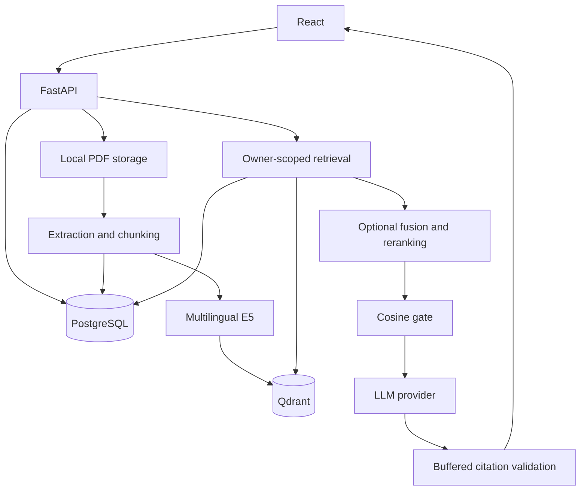

# DocuAsk

[](https://github.com/bhhvcf7-glitch/docuask/actions)

Ask questions about Arabic and English PDFs and inspect citations on their original pages.

## Status

| Component | Status |
| --- | --- |
| Authentication | Argon2, JWT access and rotating refresh tokens |
| Documents | Owner-scoped upload, deduplication, retry and deletion |
| Extraction | pdfplumber, PDFium fallback, optional OCR |
| Retrieval | multilingual-e5-small dense default; optional hybrid and reranking |
| QA | Buffered answers with structural citation validation |
| Conversations | History and follow-up rewriting |
| Viewer | PDF pages and exact highlights where available |
| Rate limiting | Per process |
| Deployment | Docker Compose and Caddy; no verified external deployment |

## Quick start

Install Git, Docker Compose v2 and Node.js 22. Clone the repository and enter it.

```bash
git clone https://github.com/bhhvcf7-glitch/docuask.git
cd docuask
```

Windows (PowerShell):

```powershell
Copy-Item .env.example .env
notepad .env
```

Linux:

```bash
cp .env.example .env
nano .env
```

Set a unique POSTGRES_PASSWORD and a random JWT_SECRET of at least 32 characters. Never commit .env. Run Ollama on the host and pull the configured model (default llama3.2:3b), or configure an OpenAI-compatible provider. For Docker, set `OLLAMA_URL=http://host.docker.internal:11434` in `.env` (the example localhost URL is for native Python). Ensure the host provider listens on an interface reachable from Docker, with firewall restrictions; do not expose Ollama publicly.

```bash
docker compose up -d postgres qdrant
docker compose build api
docker compose run --rm --no-deps api alembic upgrade head
docker compose up -d api
```

In another terminal:

```bash
cd frontend
npm ci
npm run dev
```

Open http://127.0.0.1:5173. Register, upload a PDF, wait for ready, ask a question and open a citation. API documentation: http://localhost:8000/docs.

## Architecture



## Evaluation

Six synthetic PDFs, 36 pages, 73 chunks (verified by corpus validation), 72 answerable and 12 unanswerable questions. The following comparison was measured in GitHub Actions run 45419569734, not on the current release candidate.

| Metric | Dense | Hybrid | Hybrid + reranker |
| --- | ---: | ---: | ---: |
| Hit@1 | 0.7639 | 0.7361 | 0.9167 |
| Hit@3 | 0.8889 | 0.8750 | 1.0000 |
| Hit@5 | 0.9861 | 0.9722 | 1.0000 |
| MRR@5 | 0.8387 | 0.8208 | 0.9583 |
| Gate recall | 1.0000 | 1.0000 | 1.0000 |
| Gate refusal accuracy | 0 | 0 | 0 |
| Retrieval p50 (ms) | 27.790 | 55.425 | 15766.760 |
| Retrieval p95 (ms) | 32.980 | 62.613 | 18054.897 |

Reranking improves ranking on this corpus at substantial CPU latency cost. Dense remains default. Retrieval is not answer accuracy; the gate refused none of the unanswerable questions. See [measured results](docs/eval/production-results.md).

## Tests

```bash
python -m pip install -e "./backend[dev]"
python -m ruff check backend
python -m pytest backend/tests -q
```

PostgreSQL integration tests require RUN_DB_TESTS=1 and a migrated test database; vector tests require RUN_VECTOR_TESTS=1 and Qdrant. Standard CI uses model substitutes.

## Limitations

- The similarity threshold is uncalibrated; citations do not prove entailment.
- Prompt injection defenses are not guarantees.
- Extraction and highlighting depend on PDF layout; OCR is off by default.
- In-process ingestion is not a durable queue. SQL, vectors and files have no shared transaction.
- Rate limits are per process; access tokens survive logout until expiry.
- No independent penetration test, load test, backup restore drill or verified external deployment.

## Documentation

[Documentation index](docs/README.md) · [Architecture](docs/architecture.md) · [Evaluation](docs/eval/README.md) · [Security](docs/security.md) · [Arabic extraction](docs/arabic-extraction.md) · [Deployment](docs/deployment.md) · [Decisions and release gates](docs/decisions.md).

[Measured results](docs/eval/production-results.md) · [Retrieval error analysis](docs/error-analysis.md).

Stable production release: **HOLD**. Verified Phase K CI (207 backend tests passed, 1 skipped) and local production smoke passed; no public deployment is verified. Answer-level runner exists but real answer results remain unmeasured.

## Demo

See the [demo walkthrough and release audit](docs/demo.md) and [operator runbook](docs/deployment.md). No live demo URL or recorded GIF is verified.

## نبذة بالعربية

DocuAsk تطبيق للإجابة عن الأسئلة من مستندات PDF العربية والإنجليزية مع استشهادات بالصفحات الأصلية. أظهرت التجربة الاصطناعية تحسن ترتيب النتائج باستخدام المراجع مقابل زيادة كبيرة في الزمن. لا تزال بوابة الرفض بحاجة إلى معايرة، ولا تثبت الاستشهادات وحدها صحة الإجابة. لم يُتحقق من نشر خارجي. للتشغيل اتبعي خطوات Quick start أعلاه، ثم افتحي الواجهة المحلية وسجلي حسابًا وارفعي ملف PDF غير حساس. [فهرس التوثيق](docs/README.md) و[القرارات](docs/decisions.md) يوضحان حدود المشروع.

## License

[MIT](LICENSE).
