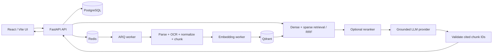

# DocuAsk

Bilingual, citation-grounded document question answering. Project status: MVP phase 6 text-based PDF ingestion implemented. Vector indexing, retrieval, and QA are not yet implemented.

## Problem

Users need answers from PDF, DOCX, TXT, and Markdown documents in Arabic, English, or both. A credible answer must identify the source document and passage rather than merely sound plausible. Arabic PDFs introduce extraction errors, mixed directionality, and orthographic variants that change retrieval quality.

## Intended capabilities

- Account-based document and chat isolation.
- Validated uploads with asynchronous, retryable ingestion.
- Arabic-aware parsing, preservation of original source text, and normalized retrieval text.
- Dense/sparse hybrid retrieval using reciprocal rank fusion and optional cross-encoder reranking.
- Answers constrained to retrieved evidence, validated source references, and explicit refusal for insufficient evidence.
- Streaming UI and PDF citation navigation with passage highlights when reliable offsets/bounding boxes are available.
- Reproducible retrieval evaluation rather than synthetic benchmark claims.

## Architecture



See [architecture](docs/architecture.md), [data model](docs/data-model.md), [MVP phase plan](docs/mvp-plan.md), and the [original design roadmap](docs/roadmap.md). The original architecture describes the eventual system, not the current implementation.

## Technology decisions

Python 3.11, FastAPI, Pydantic v2, SQLAlchemy 2 async, Alembic, PostgreSQL, Redis/ARQ, Qdrant, multilingual-e5 with a benchmarked bge-m3 alternative, optional multilingual cross-encoder, configurable OpenAI-compatible/Ollama providers, React/TypeScript/Vite/Tailwind, TanStack Query, React Router, react-pdf, SSE, Prometheus, structlog, pytest and Vitest.

## Status and verification

| Item | State |
| --- | --- |
| Architecture and data design | Drafted; MVP plan supersedes original delivery order |
| FastAPI /health and OpenAPI schema | Implemented; tested in GitHub CI |
| Docker Compose API, PostgreSQL, Qdrant | Defined with env-based configuration; container startup not verified here |
| GitHub Actions Ruff/pytest/PostgreSQL migrations | Workflow configured; see Actions for actual run status |
| Pydantic Settings and structlog | Implemented with configuration and request-log tests |
| MIT LICENSE | Added |
| SQLAlchemy users/documents/chunks | Implemented; database constraints and tenant-scoped reads tested in CI |
| Alembic upgrade/downgrade | Migration supplied; CI checks both directions |
| Auth registration, login, /auth/me | Implemented; see GitHub Actions for test status |
| Argon2id passwords and JWT | Implemented; no refresh tokens yet |
| PDF upload and local storage | Implemented; SHA-256 dedup and validation tests in CI |
| Document listing / status | Implemented, authenticated and owner-scoped |
| PDF ingestion background task | Implemented with queued -> processing -> ready/failed transitions |
| Arabic normalization and page-aware chunks | Implemented with extraction and chunk tests |
| Retrieval and answer generation | Not implemented |
| UI | Not implemented |
| Evaluation results | Not measured |
| Deployment | Not deployed |

**This is an API and database skeleton, not yet a document Q&A application.** No evaluation metrics or live deployment URLs are claimed.

## Local development (phase 6)

Requires Python 3.11, Docker Engine with the Compose plugin, and Make (Git Bash or WSL on Windows). Create a local env file before starting the stack. Set both POSTGRES_PASSWORD and JWT_SECRET to independent random values (JWT_SECRET must be at least 32 characters). Uploads use the Docker volume `uploads_data`:

```bash
cp .env.example .env
# Change POSTGRES_PASSWORD in .env to a unique local password.
make dev
make migrate
curl http://localhost:8000/health
```

Expected health JSON: `{"status":"ok"}`. OpenAPI docs: `http://localhost:8000/docs`. PostgreSQL and Qdrant are internal Compose services at this stage; the API does not access them yet.

Document endpoints: `POST /documents` takes multipart `file` (PDF only), returns 201 and a `queued` record; `GET /documents` lists only your documents; `GET /documents/{document_id}` returns metadata or 404 when absent or not owned. The upload checks filename extension, declared MIME, `%PDF-` signature, parseability, encrypted status, page presence, and byte limit. It hashes the streamed file and rejects duplicate SHA-256 values per user with HTTP 409. Local files have opaque UUID-based paths; returned metadata never exposes storage paths. Storage is local, not cloud-backed. Max PDF size defaults to 10 MiB, configurable with `MAX_UPLOAD_BYTES`. `STORAGE_DIR` defaults to `storage` in local Python and `/app/storage` in Compose. Newly uploaded files start as `queued` and ingestion runs as an in-process FastAPI background task after the HTTP response. Text-based PDFs become `ready` with stored page-numbered chunks; scanned/image-only PDFs become `failed` because OCR is not implemented. Parser safeguards do not fully defend against every malicious PDF; do not expose the MVP publicly yet.\n\nThe authentication endpoints are `POST /auth/register` (201), `POST /auth/login` (JWT access token), and `GET /auth/me` (Bearer token required). Registration requires at least 12 password characters. Email addresses are case-folded at the API boundary; existing pre-normalization database records should be migrated before accepting public registrations. Token lifetime defaults to 30 minutes. There is no refresh-token or login rate-limiting support yet, and this MVP must not be exposed to the public internet without those controls.

For local checks:

```bash
python -m pip install -e './backend[dev]'
make lint
make test
```

The database integration tests are skipped by default outside CI. To run them locally, use a PostgreSQL database with the migration applied, set POSTGRES_HOST/PORT and POSTGRES_PASSWORD appropriately, and use `RUN_DB_TESTS=1 python -m pytest backend/tests -q`. CI runs the migration and the integration tests against PostgreSQL 16. `make migrate` uses the running API container and does not execute automatically when starting the stack.

Stop containers with `make down`. Docker Compose startup was not executed in the authoring environment because Docker was unavailable; verify it locally. PostgreSQL credentials are read from the uncommitted .env file; the example value is for local setup only. Changing credentials after initializing a database volume does not update the existing PostgreSQL user password. Remove the volume only if you intend to destroy local data.

\n## Upload verification\n\nIn PowerShell, use Swagger UI at `http://localhost:8000/docs` to register, log in and authorize with the access token. Then call `POST /documents` using a small text-based PDF and inspect `GET /documents`. The initial upload response may show `status: queued`. Poll `GET /documents/{document_id}` for `ready` or `failed`; this is an in-process background task, not a durable queue. The status may remain `processing` after an API process crash.\n\nFor real PostgreSQL-backed integration tests outside CI, set `RUN_DB_TESTS=1` with a migrated database and run `python -m pytest backend/tests -q`. CI runs these against PostgreSQL 16. Keep the `uploads_data` Docker volume if you want to preserve files across restarts. The application does not currently reconcile files left behind by a process crash or recover interrupted ingestion tasks.\n\n## Ingestion (phase 6)

Uploaded PDF files are checked with pdfplumber (maximum 200 pages). Nonempty pages are extracted separately; blank pages are skipped while their page numbers remain stable. Arabic retrieval text removes tatweel and combining marks, folds alef and alif maqsura/yaa variants, and maps Arabic-Indic and Eastern Arabic digits to ASCII digits. The original extracted text is stored separately from normalized text.

Chunks are paragraph-aware, target at most 900 characters, overlap up to about 120 characters, and never span multiple pages. Status transitions: queued -> processing -> ready, or processing -> failed for unreadable/empty PDFs. The ingestion task uses a fresh database session after the upload response is committed. It does not use a durable queue; there are no automatic retries, OCR, or vector embeddings yet.

PDF extraction can produce reversed or disordered Arabic glyph sequences. The app does not reverse arbitrary RTL runs because that corrupts correctly extracted text. Better bidi handling and geometry-based citations require dedicated fixtures.

## Evaluation table

The planned comparison will be populated only after local runs over a versioned bilingual dataset.

| Retrieval configuration | Hit@5 | MRR@10 | Latency p50 / p95 |
| --- | --- | --- | --- |
| Dense only | Not measured | Not measured | Not measured |
| Sparse only | Not measured | Not measured | Not measured |
| Hybrid RRF | Not measured | Not measured | Not measured |
| Hybrid + reranker | Not measured | Not measured | Not measured |

## Known limitations

Database schema now implemented; future architecture remains a design. Email normalization, JWT authentication and per-user upload deduplication are implemented; page-based extraction and chunking run in phase 6; vector indexing and citations are still pending. PDF text highlighting is not guaranteed by character offsets alone: precise text-layer spans or bounding-box mapping must be retained during extraction. OCR text alignment will need a separate mapping and confidence tracking. LLM citations require backend validation and cannot prove every individual claim without further evidence checks.

## Demo

Demo GIF: pending first usable release.

## License

Licensed under the [MIT License](LICENSE).
