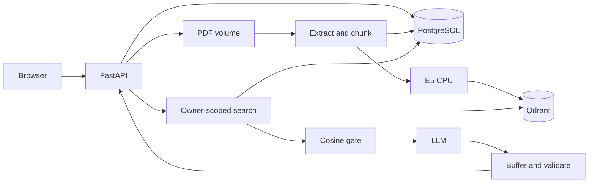
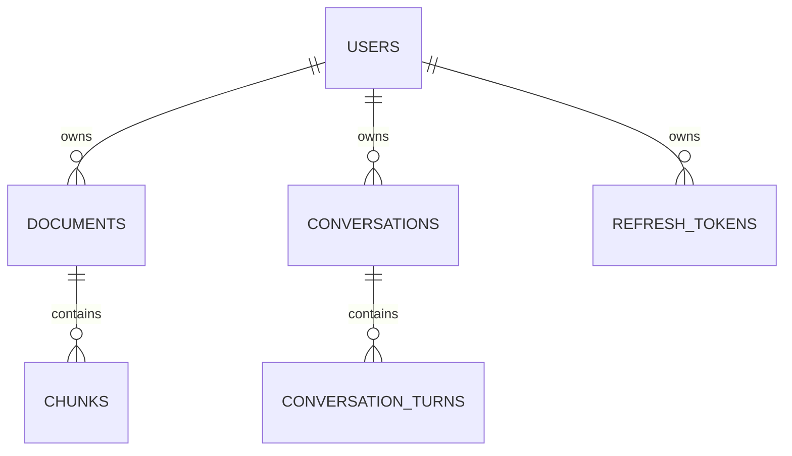

# Current architecture / البنية الحالية

React 19, TypeScript and Vite provide Arabic RTL and English LTR UI. FastAPI exposes authenticated REST endpoints and cancellable SSE. PostgreSQL is authoritative for ownership, document status and conversation history; Qdrant stores dense vectors. Local volumes store original PDFs. No Redis, ARQ, object storage, Prometheus or distributed workers are implemented.

## Runtime data model

The six ORM tables are defined in [models.py](../backend/app/db/models.py). Email has a unique lower-case expression index. Document hashes are unique per owner. A composite document/owner foreign key constrains chunks; ordinal is unique per document and page numbers are positive. Refresh tokens store digests, family IDs and expiry/use timestamps. Conversation turns store question and answer text, not durable citation mappings. Alembic migrations define the deployed schema.

## Request and document lifecycle

Upload validates the PDF, stores the original and schedules in-process ingestion. Atomic queued-to-processing claims reduce duplicate work. Extraction, normalization, chunking and embedding precede ready status. Startup recovers stale processing and queued rows; a periodic sweep fails stale queued rows for explicit retry. No attempt fencing, durable queue or shared SQL/vector/files transaction is claimed.

Search filters Qdrant by owner and resolves results through SQL owner and ready-status checks. Dense is default. Optional PostgreSQL lexical search and RRF fuse results; optional CPU cross-encoder reorders candidates. Original cosine scores remain the QA gate. The server constructs numbered source labels, buffers provider output and validates citation structure before release. Conversation answers are committed before delivery. The browser shows generation progress without exposing unvalidated tokens.

See [QA](grounded-qa.md), [conversations](conversations.md), [viewer](pdf-viewer.md), [security](security.md) and [extraction](arabic-extraction.md) for details.

العربية: PostgreSQL هو المرجع لحالة المستند وملكيته، وQdrant للاسترجاع المتجهي. يتحقق الخادم من الاستشهادات قبل عرض الإجابة، ولا يضمن ذلك صحة المعنى. المعالجة داخل عملية واحدة وليست طابورًا موزعًا.
