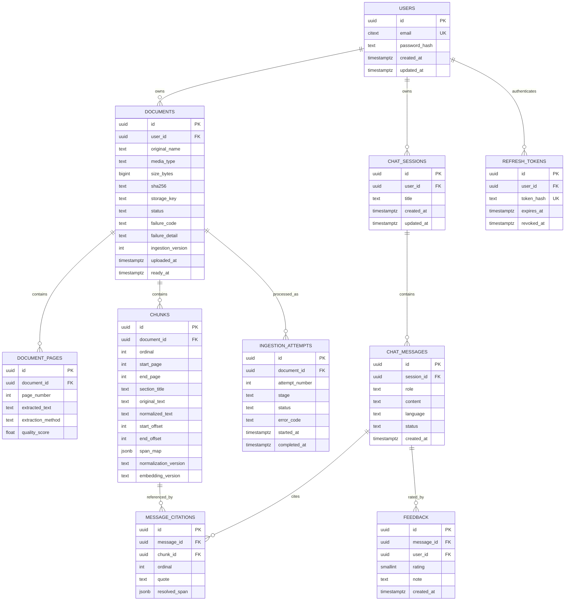

# Relational model (proposal)

All IDs are UUIDs; timestamps are timezone-aware UTC. SQLAlchemy 2.0 async ORM and Alembic own schema changes. The diagram is logical, not a migration.

## Ownership and constraints

- `users.email` is normalized and unique case-insensitively (`citext` or a unique expression index on `lower(email)`).
- `documents`: unique `(user_id, sha256)` for active deduplication; a soft deletion strategy requires a partial unique index instead. `status` constrained to `queued`, `processing`, `ready`, `failed`.
- `document_pages`: unique `(document_id, page_number)`; page numbers are one-based for user-facing citations. For non-paginated formats, a synthetic page 1 can be used but must be labeled accordingly.
- `chunks`: unique `(document_id, ordinal, ingestion_version)` if chunk versions are retained; consider separate `chunk_versions` or replacement semantics before migration. Offsets refer to a specified page text version; `span_map` carries glyph/word geometry for reliable highlight mapping when available.
- `chat_messages`: role enum `user`/`assistant`/`system` only where persisted system role is warranted; separate status for interrupted streams. An answer can cite multiple chunks.
- `feedback`: rating constrained to `-1` or `1`; unique `(message_id, user_id)`; feedback ownership verified against session user.
- `refresh_tokens`: store hash only, rotate and revoke token families after suspected reuse.
- `ingestion_attempts`: unique `(document_id, attempt_number)`, with durable stage/error codes and retry classification.

## Isolation enforcement

All user-scoped repository reads accept the authenticated `user_id` and include it in SQL joins/filters. For citation resolution, join `chunks -> documents` and enforce `documents.user_id = principal.id`; do not resolve `chunk_id` by primary key alone. Qdrant searches use a server-generated `user_id` filter as well as selected document IDs checked against PostgreSQL.

PostgreSQL row-level security is a defense-in-depth candidate, but does not replace application-level tenant checks. Concurrent deletion and ingestion races require explicit transactional state transitions, idempotent index operations and cleanup.

## Qdrant collection payload

`point_id` is a deterministic UUID derived from document ID, ingestion version and chunk ordinal. Payload fields: `user_id`, `document_id`, `chunk_id`, `start_page`, `end_page`, `section_title`, `language`, `ingestion_version`, `embedding_version`, `created_at`. Named dense/sparse vectors allow RRF fusion, with collection configuration versioned and benchmarked against the deployed Qdrant release.
